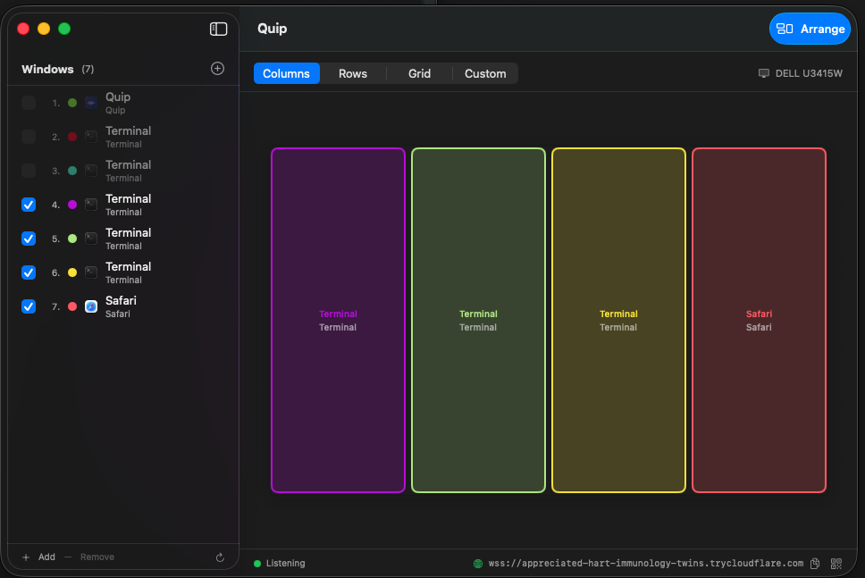

#  Quip

Talk to your Claude instances. All of them. From your couch. No keyboard needed.

Quip turns your iPhone into a voice remote for any number of [Claude Code](https://claude.ai/claude-code), Codex and Grok sessions running in Terminal or iTerm2 on your Mac. Just speak your prompt and it lands in the right terminal.

> **Platforms:** the macOS and iOS apps (with Apple Watch) are current. The Linux and Android apps are older and haven't been updated to match. They need significant work before their next release.


### Desktop


### iPhone (arranged view)


## The idea

You're running 4 Claude sessions across different projects. You don't want to walk over to your keyboard every time you have a thought. You just want to say "refactor the auth middleware" and have it go to the right Claude.

That's Quip. Push-to-talk prompting from your phone.

## Features

**Talk and type**
- **Hands-free with the volume buttons:** **volume up** steps to the next window, **volume down** starts talking, and **any volume button** stops. No need to look at the screen to pick a terminal and speak.
- **Push-to-talk transcription:** the Mac transcribes with Whisper (large-v3 turbo, with small.en as a fallback), biased toward your project's vocabulary and correcting common mishearings. When the Mac is away, the phone dictates on its own (SpeechAnalyzer). Auto-send when you stop speaking is optional.
- **Works with Claude Code, Codex and Grok:** slash commands, prompts and the slash palette follow whichever agent is in the selected window.
- **Answer prompts with one tap:** Yes / No and numbered choices, checkbox menus, inline choices, and accepting Claude's ghost-text suggestions.
- **Keyboard and quick buttons:** Return, Ctrl+C, Esc, `/plan`, restart Claude, clear context, plus your own buttons, each with its own icon and color. Hold a button to edit, recolor, remove or send it to another window, and drag to rearrange.
- **Broadcast:** send one prompt to several windows at once.

**Prompts**
- **Prompts hub:** one place to use and edit prompts. It has search ranked by relevance and by what you use most per agent, `{{variables}}` the Mac fills in at paste (folder, agent, clipboard and more), and prompts that only show for one project.
- **VibeCut prompt sync:** pull your VibeCut prompt catalog and packs into Quip, tagged by project and never sent off the device ([integration contract](docs/vibecut-prompt-inherit.md)).
- **Prompt and button packs:** share and import reusable setups as `.quippack` files.
- **Content share intake:** accept `quip://share` links from other apps and turn the content into a reviewed prompt ([integration contract](docs/content-share-intake.md)).

**See what's happening**
- **Live window layout:** every terminal and Simulator mirrored on your phone, with each session's state (thinking, waiting for you, plan mode).
- **Terminal output:** read any terminal from the phone, scrolled to where you left it.
- **Claude's previews:** when Claude Code opens an image or PDF on the Mac, it appears on the phone above that terminal. You can view it full screen with pinch zoom, and close it on the Mac. Only files Claude opens are sent, never your own Preview windows.
- **Push notifications:** alerts say which session is asking and what, carry the answers as buttons, and arrive bundled. There's also a Live Activity on the Lock Screen and an Apple Watch app that taps you when a session needs you.
- **QA Mode:** pair a Simulator with a terminal for side-by-side iteration.

**Windows**
- **Arrange windows** on your Mac with one tap, or save and reuse layout presets. Windows are tracked per display.
- **Pin** a window to the top, **minimize** one from the phone and bring it back from a tray, and focus any window from the phone.
- **Pick up where you left off:** the phone reopens on the window you were using, with unsent text kept per window. After time away it opens on a window that's asking you something.
- **Remote in:** one tap from a window opens your remote-desktop app on that Mac.

**Reliability**
- **Quip stays up:** the Mac app restarts itself after a crash or a hang, and stops trying if it keeps crashing. When the Mac can't be reached, the phone says why in plain words and can turn Quip back on.
- **Know what you're running:** both apps show their version, build number and commit, and phone Settings names the Mac build it's paired with.

## Connecting

Open both apps and pair once: scan the QR code in the Mac app, tap a `quip://pair` link, or use the Mac's **Send to iPhone** button. Connections need a PIN, which you set in the Mac's **Security** settings. Local connections need it too by default; you can turn that off in **Connection** settings.

The Mac app's **Connection** settings has three network modes:

| Mode | Use it for |
|---|---|
| **Local only** | The same Wi-Fi as the Mac. The phone finds the Mac automatically (Bonjour/mDNS). |
| **Tailscale** | Anywhere your phone and Mac share a [Tailscale](https://tailscale.com) tailnet. Quip detects the Mac's MagicDNS name (or its 100.x address) from the `tailscale` CLI. On the same Wi-Fi it still prefers the faster local path. |
| **Cloudflare Tunnel** | Remote use with no VPN. A `cloudflared` binary is bundled, so there's nothing to install and no account is needed. Some features stay local-only for privacy: Claude's previews and local-only prompts are never sent over the tunnel. |

On the phone, a **Use Local Network** switch forces the local path. Paired Macs are kept across a reinstall.

### Mac permissions

Quip asks for these on first use:
- **Accessibility:** typing into terminals and arranging windows.
- **Automation:** controlling Terminal and iTerm2.
- **Screen Recording:** window screenshots on the phone.

The menu bar has a **Fix Permissions…** item if a grant goes missing after an update.

## Building

### macOS + iOS

Requires macOS 14+, iOS 17+, Xcode 16+, and [XcodeGen](https://github.com/yonaskolb/XcodeGen) **2.44.1**. Newer XcodeGen releases (2.45.x) generate a broken iOS project; CI pins 2.44.1.

```bash
cd QuipMac && xcodegen generate && cd ..
cd QuipiOS && xcodegen generate && cd ..
```

**Build the Mac app:**

```bash
xcodebuild -project QuipMac/QuipMac.xcodeproj -scheme QuipMac build
```

The bundled `cloudflared` (for the remote tunnel) is **not** committed to the repo — a pre-build step (`tools/fetch-cloudflared.sh`) downloads the pinned Cloudflare release and verifies its SHA-256 the first time you build. It needs network on a clean build; run `tools/fetch-cloudflared.sh` by hand to pre-fetch (e.g. for offline builds). To update cloudflared, bump `VERSION` and both hashes in that script.

**Build and install the iPhone app over the air** on your paired device:

```bash
# Build (use the generic destination — see the notes on why, not id=<device>)
xcodebuild -project QuipiOS/QuipiOS.xcodeproj -scheme QuipiOS \
  -destination 'generic/platform=iOS' -derivedDataPath QuipiOS/build build

# List paired devices with `xcrun devicectl list devices`, then install:
xcrun devicectl device install app --device "<your-iphone>" \
  QuipiOS/build/Build/Products/Debug-iphoneos/Quip.app
```

For CI or a build-only run, just drop the install step (and `-derivedDataPath`).

**Notes**

- **First-trust gate (not a build defect):** a development-signed app installs to the home screen but won't launch until its certificate is trusted once. Until then the icon shows an "Untrusted Developer" prompt and `devicectl ... process launch` returns `invalid code signature ... not been explicitly trusted`. Clear it once by running the app from Xcode (▶ Run) or trusting the developer under **Settings → General → VPN & Device Management**; later installs don't need this repeated.
- **Use `generic/platform=iOS`, not `id=<device>`:** an `id=` Debug build emits a debugger-coupled `Quip.debug.dylib` / `__preview.dylib` pair that the app expects the debugger to inject, so it won't launch standalone from a home-screen tap.
- **Don't edit `Info.plist` directly:** `QuipMac/Info.plist` and `QuipiOS/Info.plist` are gitignored and regenerated from `project.yml` by `xcodegen generate`. (`.xcodeproj` files stay tracked so fresh clones open in Xcode without running `xcodegen` first.)

### Android (not updated for this release)

Requires Android SDK 34 and Java 17.

```bash
cd QuipAndroid && ./gradlew assembleDebug
adb install app/build/outputs/apk/debug/app-debug.apk
```

Or download the APK from the [latest release](https://github.com/jboert/Quip/releases).

### Linux (not updated for this release)

Requires Rust 1.75+, GTK4, and libadwaita. On openSUSE Tumbleweed:

```bash
sudo zypper install gtk4-devel libadwaita-devel gcc pkg-config
# For X11:
sudo zypper install xdotool wmctrl
# For Wayland (sway):
sudo zypper install ydotool wtype

cd QuipLinux && cargo build --release
```

The binary will be at `QuipLinux/target/release/quip-linux`.

**Supported display servers:**
- **X11** — full support (xdotool/wmctrl for window management)
- **Wayland (sway)** — full support via sway IPC
- **Wayland (Hyprland)** — window enumeration + arrangement
- **Wayland (KDE Plasma)** — full support via kdotool (install `kdotool`; uses ydotool/wtype for input)
- **Wayland (GNOME)** — full support via [Window Commander](https://extensions.gnome.org/extension/7302/window-commander/) extension (uses ydotool/wtype for input)

## How it works

Your phone records speech and sends it over a WebSocket to the Mac, which transcribes it (or the phone transcribes it itself when the Mac is away). The app injects the text into whichever terminal window you selected.

The Mac app broadcasts your window layout to the phone in real-time, so you always see what's where.

```
  Phone                            Mac        
  +---------------+                +------------------+
  | speak prompt  |   WebSocket    | inject into      |
  | pick window   | ============> | correct terminal |
  | see layout    | <============ | broadcast layout |
  +---------------+                +------------------+
```

## License

GPLv3 — see [LICENSE](LICENSE)
